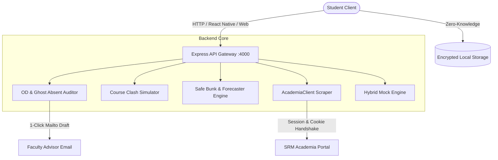

# CampusPulse ⚡

<p align="center">
  
  
  
  
  
</p>

> **CampusPulse** is an open-source, zero-knowledge, 100% free campus companion built to solve real daily student friction points: catching uncredited On-Duty (OD) records, eliminating course registration clashes, forecasting safe bunks, and decoding labyrinthine campus buildings.

---

## 🚀 Key Features

### 1. 🚨 "Ghost Absent" Detector & Automated OD Auditor
* **Discrepancy Engine**: Automatically cross-references scheduled timetable hours with marked attendance logs.
* **Catch Ghost Absences**: Flags instances where professors mistakenly mark a student "Absent" during approved OD events (e.g. Hackathons, sports tournaments).
* **1-Click Appeal Email Generator**: Pre-formats an official letter to the Faculty Advisor (FA) with student registration numbers, subject codes, and linked certificate IDs before the 7-day condonation cutoff.

### 2. 🎰 Course Registration (Enrollment) Clash Simulator
* **Pre-Enrollment Planner**: Switch between **Plan A**, **Plan B**, and **Plan C** before university portals open.
* **Live Conflict Matrix**: Live validation of slot overlap (Slot A–G, Lab P1–P5) preventing timetable clashes before entering portal lotteries.
* **⚡ Quick-Copy Bar**: 1-tap copy of formatted course codes and faculty numbers for ultra-fast portal submission.

### 3. 🛡️ Safe Bunk & Deficit Forecaster
* Dynamic target selector (75%, 80%, 85%).
* Tells you exactly how many hours you can safely skip or must attend to recover from a deficit.

### 4. 🗺️ Rotating Day-Order Timetable & Room Decoder
* Decodes cryptic room codes:
  * `TP-502` ➔ **Tech Park, 5th Floor, Room 502 (Nearest: Lift B)**
  * `UB-604` ➔ **University Building (UB), 6th Floor (Nearest: East Stairwell)**
  * `BEL-201` ➔ **Believers Block, 2nd Floor (Near Bio-Engg Connector)**

### 5. 🔒 Zero-Knowledge Security & Hybrid Engine
* Credentials never leave the device.
* Works seamlessly in **Hybrid Mode**: loaded with realistic B.Tech CSE (Year 3) data for local testing, backed by a reverse-engineered scraper client for live Academia portal connection.

---

## 🏛️ Architecture



---

## 🛠️ Getting Started

### Prerequisites
- Node.js (v18+)
- npm

### 1. Installation
```bash
# Clone the repository
git clone https://github.com/KoushikRajan47/campuspulse.git
cd campuspulse

# Install root dependencies
npm install

# Install frontend dependencies
cd frontend
npm install
cd ..
```

### 2. Launch Local Web Companion
```bash
# Terminal 1: Backend Server
node src/server.js

# Terminal 2: Web Preview
cd frontend
npm run dev
```
Open **`http://localhost:5173/`** in your browser.

### 3. Launch React Native Mobile App (Expo)
```bash
cd mobile
npm install
npx expo start
```
Scan the QR code with **Expo Go** on Android or iOS.

---

## 🤝 Contributing
Contributions are warmly welcomed! Please check out [CONTRIBUTING.md](./CONTRIBUTING.md) for good first issues and development setup instructions.

---

## 📜 License
Distributed under the **MIT License**. See [LICENSE](./LICENSE) for details.
